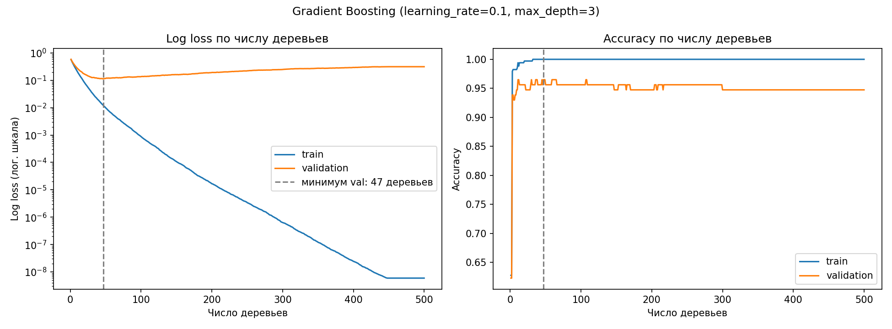
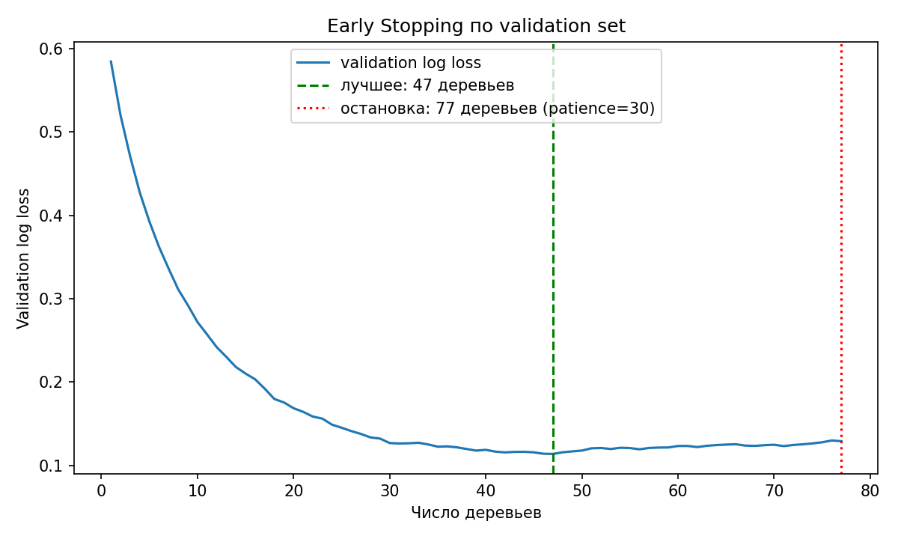
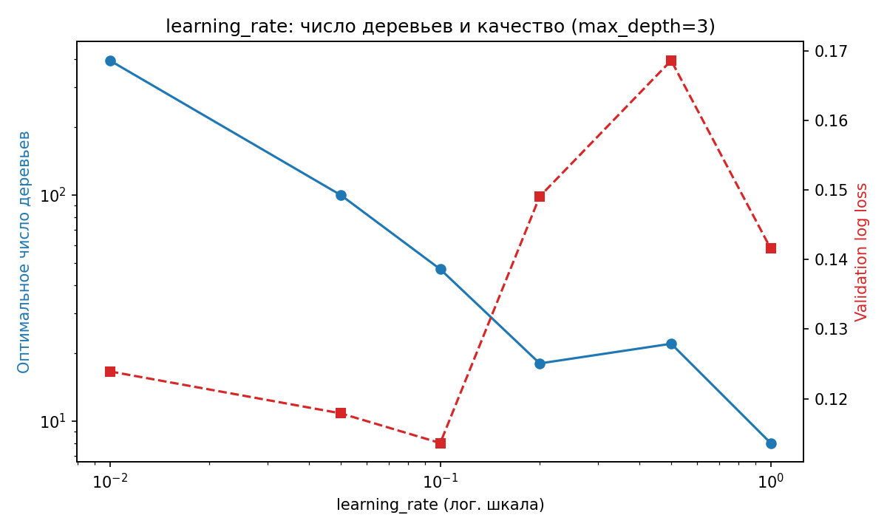
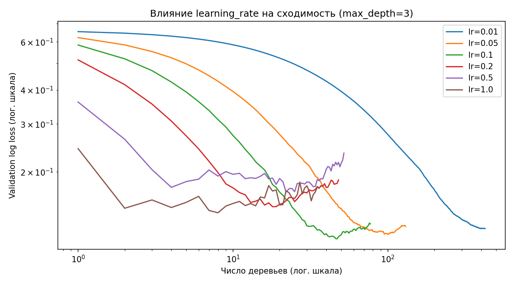
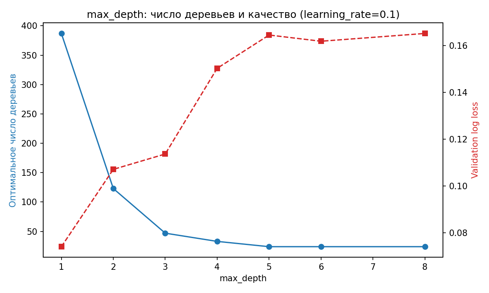
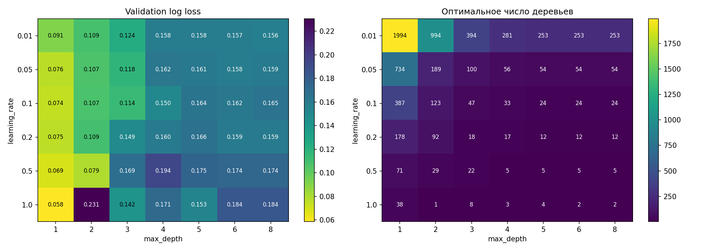
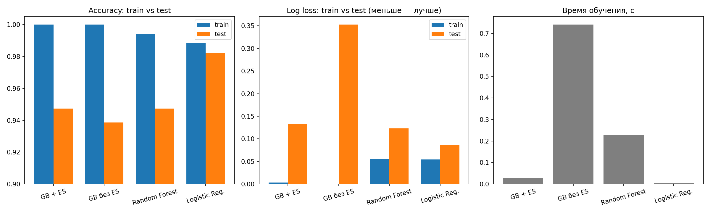
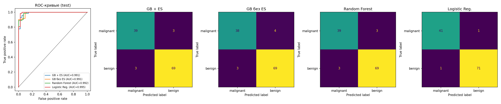

# ML Project 8 — Variant B
## Gradient Boosting with Early Stopping

Практическая работа по машинному обучению: градиентный бустинг деревьев решений
с ранней остановкой (Early Stopping) по validation set, исследование влияния
`learning_rate` и `max_depth` и сравнение с Random Forest и Logistic Regression.

## 1. Цель работы

- Использовать Gradient Boosting (`sklearn.ensemble.GradientBoostingClassifier`).
- Реализовать Early Stopping и отслеживать качество модели на validation set.
- Определить оптимальное количество деревьев.
- Исследовать влияние `learning_rate` и `max_depth`.
- Сравнить Gradient Boosting с Random Forest и Logistic Regression на train и test.
- Измерить время обучения и указать версии библиотек.

## 2. Данные

**Breast Cancer Wisconsin (Diagnostic)** из `sklearn.datasets.load_breast_cancer`:
569 опухолей, 30 числовых признаков, бинарная классификация
(0 = malignant, 212 объектов; 1 = benign, 357 объектов). Пропусков нет.

**Почему этот датасет.** В ML Project 7 использовался датасет House Prices
(`train.csv`, задача регрессии `SalePrice`). Logistic Regression, которую требует
вариант B, — модель классификации, поэтому тот датасет не подходит, и выбран
Breast Cancer. Схема разделения данных взята из ML Project 7 без изменений:

| Выборка | Доля | Объектов | Назначение |
|---|---|---|---|
| train | 60% | 341 | обучение моделей |
| validation | 20% | 114 | Early Stopping и подбор гиперпараметров |
| test | 20% | 114 | только финальная оценка |

`train_test_split(test_size=0.20, random_state=42)`, затем
`train_test_split(test_size=0.25, random_state=42)` — как в ML Project 7.
Дополнительно добавлен `stratify=y` (в регрессии Project 7 его не было), чтобы
доля классов была одинаковой во всех трёх выборках.

**Защита от утечки данных:**
- test set не используется ни для Early Stopping, ни для подбора параметров —
  только один раз в конце;
- `StandardScaler` для Logistic Regression находится внутри `Pipeline` и
  обучается только на train;
- выбор лучших параметров всех трёх моделей делается по validation log loss.

## 3. Установка и запуск

Требуется Python 3.10+.

```bash
git clone https://github.com/Yunus08444/ML-Project-8.git
cd ML-Project-8
python -m venv .venv
# Windows:
.venv\Scripts\activate
# Linux / macOS:
source .venv/bin/activate

pip install -r requirements.txt
python main.py
```

Скрипт работает около минуты и сохраняет все таблицы и графики в папку `results/`.

> Windows: если при импорте появляется `DLL load failed ... слишком большую длину`,
> создайте виртуальное окружение в папке с коротким путём.

## 4. Структура проекта

```
ML-Project-8/
├── main.py            # весь эксперимент
├── requirements.txt   # зависимости с версиями
├── README.md
├── .gitignore
└── results/           # создаётся при запуске main.py
    ├── summary.md                     # итоговый отчёт с таблицами
    ├── versions.csv                   # версии Python и библиотек
    ├── early_stopping_methods.csv
    ├── gb_grid_results.csv            # сетка learning_rate × max_depth
    ├── learning_rate_effect.csv
    ├── max_depth_effect.csv
    ├── rf_validation.csv
    ├── logreg_validation.csv
    ├── model_comparison.csv           # train vs test, время обучения
    ├── gb_feature_importance.csv
    └── 01…09_*.png                    # графики
```

## 5. Алгоритм

### Gradient Boosting
Ансамбль строится последовательно. Модель начинается с константы
(логарифм шансов классов), затем на каждом шаге `m`:

1. считаются антиградиенты функции потерь (log loss) по текущим предсказаниям —
   «остатки», которые модель пока объясняет плохо;
2. на эти остатки обучается неглубокое дерево регрессии `h_m(x)` глубины `max_depth`;
3. предсказание обновляется: `F_m(x) = F_{m-1}(x) + learning_rate · h_m(x)`.

`learning_rate` (shrinkage) уменьшает вклад каждого дерева: чем он меньше,
тем больше деревьев нужно, но обучение обычно стабильнее.
`max_depth` задаёт сложность одного дерева и порядок взаимодействий признаков
(`max_depth=1` — «пеньки», аддитивная модель без взаимодействий).

### Early Stopping
Если добавлять деревья бесконечно, бустинг запоминает train
(train log loss → 0) и начинает переобучаться. В `main.py` реализована
собственная ранняя остановка (функция `fit_with_early_stopping`):

1. модель обучается с `warm_start=True`, деревья добавляются по одному;
2. после каждого дерева считается **log loss на validation set**;
3. запоминается число деревьев с наименьшим validation log loss;
4. если `PATIENCE = 30` деревьев подряд улучшения не было (больше чем на `TOL = 1e-4`),
   обучение останавливается (верхний предел — 2000 деревьев);
5. финальная модель обучается заново с найденным оптимальным `n_estimators`.

Для сравнения запускается и встроенный механизм sklearn (`n_iter_no_change`),
который сам отрезает 20% от train под внутреннюю валидацию.

### Модели для сравнения
- **Random Forest** — 300 независимых глубоких деревьев на бутстрэп-выборках,
  `max_depth` выбран по validation из {None, 4, 8, 12}.
- **Logistic Regression** — линейная модель с `StandardScaler`, параметр
  регуляризации `C` выбран по validation из {0.01, 0.1, 1, 10, 100}.

## 6. Результаты

Версии, на которых получены результаты: **Python 3.14.3, scikit-learn 1.8.0,
numpy 2.4.4, pandas 3.0.2, matplotlib 3.10.8**. Все модели используют
`random_state=42`, поэтому метрики воспроизводимы; время обучения зависит от компьютера.

### 6.1. Кривые обучения и Early Stopping (`learning_rate=0.1`, `max_depth=3`)



- Train log loss монотонно падает почти до нуля (~1e-8), train accuracy = 1.0
  уже после ~30 деревьев.
- Validation log loss минимален (**0.114**) при **47 деревьях**, после чего растёт
  и при 500 деревьях достигает 0.31 — классическое переобучение.
- Early Stopping остановил обучение на 77-м дереве (47 + patience 30) и выбрал
  **47 деревьев**: validation accuracy 0.965, ROC AUC 0.990.
- Встроенный `n_iter_no_change` остановился на 59 деревьях (validation accuracy 0.947):
  ему доступно меньше данных для обучения (80% от train), а его валидация меньше и шумнее.



### 6.2. Влияние `learning_rate` (`max_depth=3`)

| learning_rate | оптимум деревьев | val log loss | val accuracy |
|---|---|---|---|
| 0.01 | 394 | 0.124 | 0.956 |
| 0.05 | 100 | 0.118 | 0.965 |
| **0.1** | **47** | **0.114** | **0.965** |
| 0.2 | 18 | 0.149 | 0.956 |
| 0.5 | 22 | 0.169 | 0.939 |
| 1.0 | 8 | 0.142 | 0.947 |



Число деревьев примерно обратно пропорционально `learning_rate`
(0.01 → 394, 0.1 → 47, 1.0 → 8). Маленький шаг даёт гладкую кривую и хорошее качество,
но в разы увеличивает время обучения. Большой шаг (≥ 0.2 для глубины 3) приводит к быстрому
переобучению и худшему validation log loss.



### 6.3. Влияние `max_depth` (`learning_rate=0.1`)

| max_depth | оптимум деревьев | val log loss | val accuracy |
|---|---|---|---|
| **1** | **387** | **0.074** | **0.982** |
| 2 | 123 | 0.107 | 0.965 |
| 3 | 47 | 0.114 | 0.965 |
| 4 | 33 | 0.150 | 0.947 |
| 5 | 24 | 0.165 | 0.956 |
| 6 | 24 | 0.162 | 0.956 |
| 8 | 24 | 0.165 | 0.956 |



Чем глубже деревья, тем меньше их нужно и тем быстрее модель переобучается.
На этом датасете лучше всего работают «пеньки» (`max_depth=1`): зависимость между
признаками и диагнозом близка к аддитивной, и сложные взаимодействия только
добавляют шум. При `max_depth ≥ 5` результаты почти совпадают — на 341 объекте деревья
упираются в `min_samples` и фактически не растут глубже.

### 6.4. Сетка `learning_rate × max_depth`



Лучшая комбинация по validation log loss: **`learning_rate=1.0`, `max_depth=1`,
38 деревьев** (val log loss 0.059). Колонка `max_depth=1` лучшая при любом
`learning_rate` (0.058–0.091), поэтому вывод о «пеньках» устойчив. Конкретный выбор
`learning_rate=1.0` — менее надёжен: validation содержит всего 114 объектов, а выбор
делался среди 42 комбинаций, поэтому оценка на validation оптимистична (на test log loss
этой модели 0.133). Для `learning_rate=0.01`, `max_depth=1` обучение дошло до лимита
2000 деревьев без остановки (оптимум 1994) — при таком малом шаге модели нужно ещё больше деревьев.

### 6.5. Сравнение моделей на train и test

| Модель | train acc | test acc | test F1 | test ROC AUC | train log loss | test log loss | разрыв acc | время, с |
|---|---|---|---|---|---|---|---|---|
| GB + Early Stopping (lr=1.0, depth=1, 38 дер.) | 1.000 | 0.947 | 0.958 | 0.991 | 0.003 | 0.133 | 0.053 | 0.027 |
| GB без Early Stopping (lr=0.1, depth=3, 500 дер.) | 1.000 | 0.939 | 0.952 | 0.991 | 0.000 | 0.353 | 0.061 | 0.731 |
| Random Forest (300 дер., max_depth=4) | 0.994 | 0.947 | 0.958 | 0.992 | 0.055 | 0.123 | 0.047 | 0.224 |
| **Logistic Regression (C=1)** | 0.988 | **0.982** | **0.986** | **0.995** | 0.054 | **0.087** | **0.006** | **0.004** |




Время — среднее по трём запускам на одном компьютере. Полные таблицы — в `results/summary.md`
и `results/model_comparison.csv`.

## 7. Выводы

1. **Early Stopping работает и важен.** Без остановки бустинг из 500 деревьев доводит
   train log loss до ~0, а test log loss растёт до 0.353 (в 2.7 раза хуже, чем у модели
   с Early Stopping) — вероятности становятся чрезмерно уверенными. Ранняя остановка
   нашла оптимум в 47 деревьев для базовых параметров (`learning_rate=0.1`, `max_depth=3`),
   и финальная модель с теми же параметрами обучается примерно в 9 раз быстрее
   (≈0.08 с вместо ≈0.74 с для 500 деревьев).
2. **`learning_rate` и число деревьев взаимозаменяемы:** уменьшение шага в 10 раз требует
   примерно в 8–10 раз больше деревьев. Малый шаг даёт более стабильное обучение, но
   дороже по времени; большой шаг быстро переобучается при глубоких деревьях.
3. **`max_depth` управляет сложностью:** на этом датасете лучшие результаты дают
   неглубокие деревья (1–2). Глубокие деревья быстрее переобучаются, и Early Stopping
   останавливает их уже через 12–33 дерева.
4. **Сравнение моделей.** На test лучшая модель — Logistic Regression
   (accuracy 0.982, ROC AUC 0.995, log loss 0.087) с минимальным разрывом train/test
   и самым быстрым обучением. Классы в Breast Cancer почти линейно разделимы
   после стандартизации, поэтому простая линейная модель выигрывает. Gradient Boosting
   с Early Stopping и Random Forest показали одинаковую accuracy 0.947 и ROC AUC ≈ 0.99,
   но у обоих ансамблей заметнее разрыв между train и test.
5. **Ограничения.** Выборки маленькие (114 объектов в validation и test), поэтому
   разница в 1–2 объекта меняет accuracy на ~0.01–0.02, а выбор лучшей комбинации
   по одной validation-выборке оптимистичен. Для более надёжной оценки стоит
   использовать повторную кросс-валидацию на train+validation.

## 8. Используемые технологии

Python, scikit-learn (`GradientBoostingClassifier`, `RandomForestClassifier`,
`LogisticRegression`), NumPy, pandas, Matplotlib.
